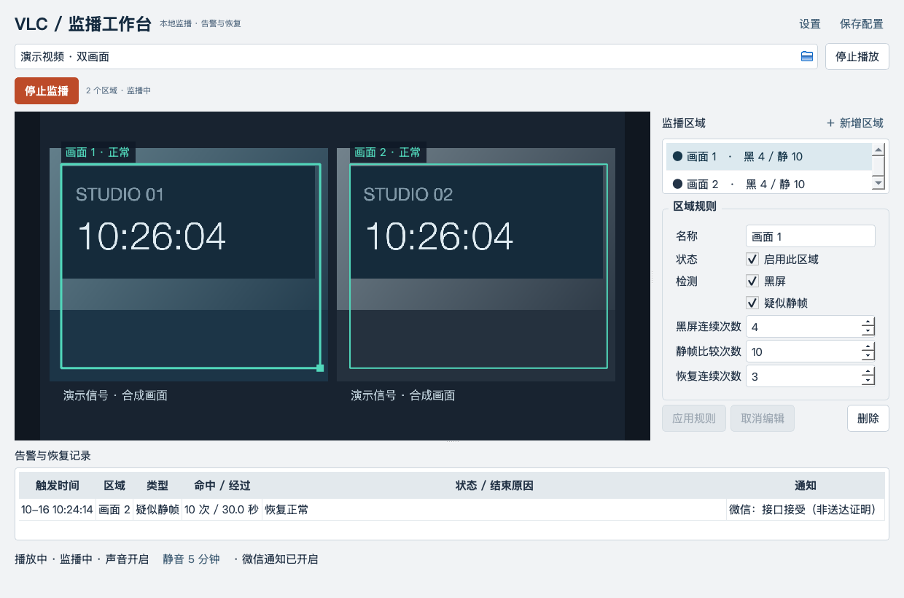

# VLC 监播

圈出视频中的关注区域，出现黑屏或疑似静帧时提醒你。



> 图为真实 Qt 界面的合成演示，不含真实直播源或微信信息。当前版本 **0.4.0 内部候选**；已完成本地 Mac 验证，Windows 原生构建和设备验收仍待执行。

## 能做什么

- 单路视频播放，多区域黑屏、疑似静帧和视频更新超时检测。
- 本地声音、视觉提醒和未确认告警周期提醒，可确认或临时静音。
- 可选微信通知：同一次异常只通知首次与正常恢复，持续期间不重复发送。
- 保存区域、规则和设置，查看告警、恢复及通知结果。不会自动播放或自动开始监播。

## 下载与准备

支持的构建目标为 **Apple Silicon Mac（ARM64）** 与 **Windows 10/11 x64**。终端用户不需要 Python，但须另外安装同架构的完整 [VLC](https://www.videolan.org/vlc/)，本工具不捆绑 libVLC。

GitHub 仓库接入后：

1. 临时构建：仓库 → **Actions** → 成功的构建 → **Artifacts**，选择对应平台。通常保留 14 天；私有仓库需要访问权限。
2. 版本构建：仓库 → **Releases**，下载对应平台 ZIP 与 SHA256；只有两平台都成功才发布。
3. Actions 下载可能外套一层 ZIP，先解外层，再解平台包。Mac 打开 `.app`；Windows 必须保留整个 `VLCMonitor` 文件夹，不能只复制 EXE。

Mac 使用内部 ad-hoc 签名，未做 Developer ID 签名和公证；Windows 未签名。不要为运行本工具全局关闭系统安全保护。Mac 最低系统版本与 Windows 设备功能仍需目标机器验证，CI 构建成功不等于实机验收。

## 四步开始

1. **打开视频**：填写地址，或点输入框右侧的文件夹图标选择本地文件，点击“播放”。也可用系统打开文件快捷键（Mac `⌘O`，Windows `Ctrl+O`）。
2. **圈出区域**：点“＋ 新增区域”，在画面中拖动框选，`Esc` 取消。建议一个小画面一个框，避开字幕和时钟。
3. **开始监播**：按需要调整连续检测/恢复次数，“应用规则”后点击“开始监播”。次数不是秒数；疑似静帧也可能是正常静态内容。
4. **设置通知**：打开“设置”，在“常规”配置本地提醒，按需在“微信通知”绑定本人微信。修改后点击主窗口“保存配置”，下次启动才保留。

设置、保存是顶栏轻量入口，静音在底部声音状态旁。更换视频须先停止播放再播放新地址，不会自动切源；重新播放后须手动开始监播。

**确认告警不等于恢复**，只停止当前事件的本地强提醒；**静音 5 分钟只影响本地声音**，不会停止微信。停止监播、编辑区域、切源和退出都不发送“恢复正常”。

## 微信通知

默认关闭；仅查看设置不会发起登录或读取凭证。启用后按需扫码、发送一次性挑战，并保留“确认是本人发送”。正常绑定无需为了新版重新绑定。

- 同一异常：首次通知 → 持续期间不重复 → 正常恢复通知。短暂异常在首次尝试前已恢复时，可合并为一条消息。
- 失败仅有限重试；超时后重试仍可能少量重复。**接口接受不代表手机送达或已读**，不确定时先核对手机。
- 关闭设置后通知继续；关闭开关会停止新通知并取消待发任务，保留绑定；解绑才删除系统凭证。退出 App 后通知停止，在途请求不能保证撤回。
- 不自动登录、不跨重启补发。凭证只存系统安全库，不降级明文。请保留其他值守渠道。

## 播放与数据边界

尝试播放本机 VLC/libVLC 支持的输入，如本地视频、HTTP(S)、RTSP、RTMP、UDP；这些不是全部实测通过的承诺。实际播放取决于 VLC 插件、编码、网络和权限；监播还需要持续可读取的视频帧与有效区域，纯音频等输入不能正常监播。

配置与历史沿用原应用的数据目录和身份，**不迁移配置 schema 或数据库表**；不要让新旧版本同时使用同一数据目录。历史保存失败会显示“部分历史未保存，仅内存有效”，本地和微信告警仍独立工作。

详见 [使用与故障提示](docs/usage.md)、[本次实施与验证记录](docs/plans/2026-10-16-implementation.md)。

## 开发与构建

固定 Python `3.12.13`、uv `0.12.18`；依赖版本以锁文件为准。

```sh
uv sync --locked --extra dev
uv run --no-sync vlc-monitor
# 离线核心回归；Windows PowerShell 用 $env:QT_QPA_PLATFORM='offscreen'
QT_QPA_PLATFORM=offscreen uv run --no-sync pytest -q
# 安全检查与独立源码附件
uv run --no-sync python tools/delivery.py audit
uv run --no-sync python tools/delivery.py scan
uv run --no-sync python packaging/source_archive.py
# 原生 Mac ARM64；Windows 运行 pwsh -File packaging/build-windows.ps1
sh packaging/build-macos.sh
```

平台 ZIP 和 UTF-8 `SHA256SUMS-<版本>-<平台>.txt` 输出到 `dist/`；用 `tools/delivery.py verify-checksums <校验文件>` 核对。完整 workflow 合同见 [.github/DELIVERY.md](.github/DELIVERY.md)。本地合成验证工具为 `tools/controlled_smoke.py`；界面截图为 `tools/ui_preview.py --actual`，均使用隔离数据和假通知服务，不测试真实手机送达。

## 许可证与分发

业务源码许可由项目权利方决定，本项目未擅自添加开源许可证。音效为原创合成并按 CC0 提供；第三方依赖详见 [THIRD_PARTY_NOTICES](docs/THIRD_PARTY_NOTICES.md)。首次上传与公开/商业分发前仍须确认源码外传权限和 Qt/FFmpeg 等依赖的对应源码及分发义务；收集许可证不等于完成法律合规验收。
